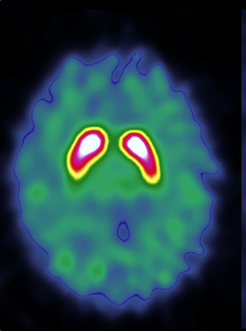
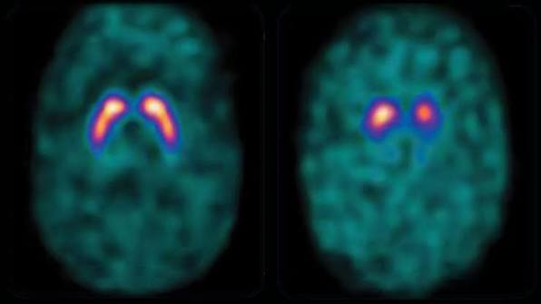
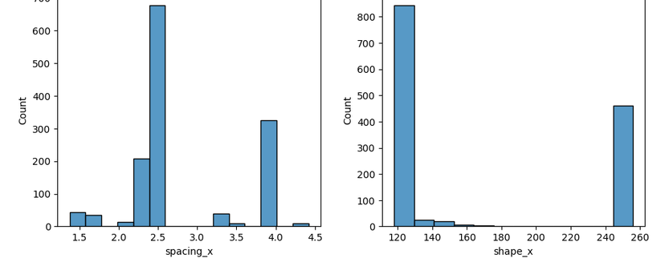
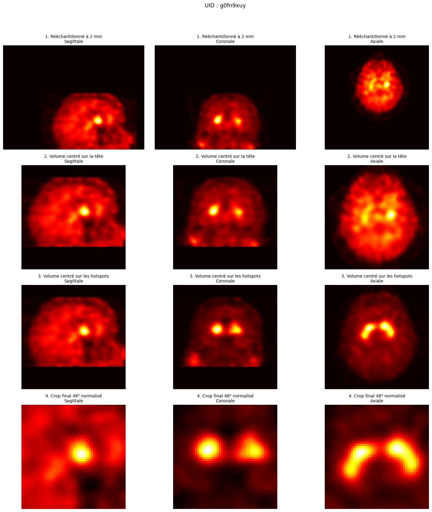
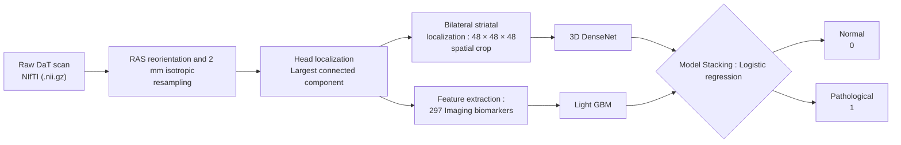

<div align="center">

  <h1>DaTParkinson : AI-based classification of DaT scans for the detection of parkinsonian syndromes </h1>


  

  <br>

</div>

## Context

Parkinsonian syndromes affect millions of people worldwide, yet diagnosing them accurately and early remains challenging. Dopamine transporter (DaT) imaging is an important tool for distinguishing neurodegenerative parkinsonian syndromes from other conditions, but reliable interpretation requires specialized expertise that is not available everywhere.

Each year, more than 20,000 DaT scans are performed in France alone. While many can be classified as normal or abnormal, approximately one in five cases remains difficult to interpret — particularly in early-stage or atypical presentations — delaying diagnosis, complicating treatment decisions, and increasing demands on specialist readers. 

However, conditions other than Parkinson’s decrease dopamine activity and cause abnormal images. Examples include the atypical parkinsonisms multiple system atrophy, corticobasal degeneration and progressive supranuclear palsy, which may look similar to Parkinson’s early on. Likewise, up to 15% of the patients meeting PD clinical criteria but showing predominant resting and postural tremor in the upper limbs might have normal results in this test, known as scans without evidence of dopaminergic deficit (SWEDD).

We want to advance AI tools for DaT scan interpretation. 


## Goal
Using a unique multicenter dataset of scans collected and annotated by French experts across ten hospital centers in France, the goal is to develop computer vision models that classify DaT scans as normal or abnormal.


The imaging data are provided as three-dimensional DaT scan reconstructions in compressed Neuroimaging Informatics Technology Initiative (NIfTI) format (.nii.gz). Each examination is a single 3D volume, and each patient is represented by one file. The filename (minus the .nii.gz extension) is the uid that links each image to its label.

In addition, participants are welcome to incorporate external datasets for training; however, use of external data is subject to important exceptions and caveats.


## Data

Please check out [data installation instructions](./data/INSTALL.md).

### Images

Each .nii.gz file contains a single 3D reconstructed volume stored as 16-bit unsigned integer voxel intensities. Note that acquisition and reconstruction parameters vary across the dataset, so images are not all the same size or resolution:

Volume dimensions differ from scan to scan (for example, 142 × 142 × 64 or 128 × 128 × 128). Your pipeline should not assume a fixed input shape.
Voxel spacing also varies (e.g., 2.46 mm and 3.895 mm isotropic), reflecting differences in scanners and acquisition protocols across contributing centers. The spacing is recorded in each file's NIfTI header and may be useful for resampling images to a common resolution.

These differences are a normal consequence of pooling data from multiple institutions, and building models that generalize across them is part of the challenge.

### Labels

train_labels.csv contains one row per DaT scan examination in the training set, with the following columns:

uid (str) — unique identifier for each DaT scan examination; matches the image filename without the .nii.gz extension
is_pathologic (float) — classification of the DaT scan examination, where 0.0 = Normal and 1.0 = Abnormal


Label example — the first five rows of train_labels.csv:

| uid      | is_pathologic |
| -------- | ------------: |
| xaji0y6d |           0.0 |
| pbhsahxt |           0.0 |
| hv3a3zmf |           0.0 |
| 8mdd4v30 |           0.0 |
| t9nt3w5u |           1.0 |

where:

* `uid` — unique identifier for each DaT scan examination; matches the image filename without the `.nii.gz` extension.
* `is_pathologic` — classification of the DaT scan examination, where `0.0` = Normal and `1.0` = Abnormal.


## Method

### DaT scan characteristics

Dopamine transporter (DaT) imaging is a nuclear medicine technique used to assess the integrity of the presynaptic dopaminergic system. In particular, DaT scans provide information about dopamine transporter availability in the striatum, a brain region composed primarily of the caudate nucleus and putamen.

In a healthy subject, DaT uptake is predominantly concentrated in the bilateral striatum, producing two relatively symmetric regions (comma-shaped striata with intact putaminal tails) of high tracer uptake. In parkinsonian syndromes associated with nigrostriatal degeneration, dopamine transporter availability is reduced. This typically results in decreased striatal uptake, often with a characteristic asymmetric reduction and a greater loss of uptake in the putamen than in the caudate nucleus. An unhealthy case shows dot-shaped striata with a smaller signal.



Consequently, the distinction between normal and pathological examinations is largely driven by imaging biomarkers : the spatial distribution, intensity, symmetry, and shape of striatal uptake. 


### Inter-center variability

The dataset combines DaT scans acquired at ten different hospital centers. As a result, acquisition and reconstruction parameters are not homogeneous across the dataset.

In particular, voxel spacing varies substantially between examinations, ranging approximately from **1.37 mm to 4.42 mm** across the contributing hospitals.



This variability is important because the same anatomical structure can occupy very different numbers of voxels depending on the acquisition resolution. For example, a structure spanning 40 mm would occupy approximately 29 voxels with a 1.37 mm spacing, but only about 9 voxels with a 4.42 mm spacing. A convolutional neural network operating directly on these voxel grids would therefore observe substantially different spatial representations of the same anatomical structures.

To reduce this source of inter-center variability, the preprocessing pipeline explicitly normalizes the spatial resolution before classification.

### Resampling and spatial cropping

Each NIfTI volume is first reoriented to the standard **RAS (Right-Anterior-Superior)** anatomical orientation. The volume is then resampled to an isotropic resolution of **2 × 2 × 2 mm** using linear interpolation.

This provides a common physical coordinate system across all examinations. A fixed-size crop can therefore correspond to approximately the same anatomical field of view regardless of the original scanner resolution.

After resampling, the head is localized using a foreground mask and connected-component analysis. The largest connected component is retained to remove irrelevant background regions and to obtain a robust localization of the head.

The striatal region is then localized using a high-intensity suprathreshold mask. The highest-intensity voxels are separated according to their position relative to the midline, allowing the left and right striatal uptake regions to be identified independently. Their estimated centers are combined to obtain a robust center for the bilateral striatal region.

A fixed **48 × 48 × 48 voxel** crop is finally extracted around this center. At 2 mm isotropic resolution, this corresponds to a physical field of view of approximately **96 × 96 × 96 mm**, providing sufficient spatial context around the striatum while removing a large portion of irrelevant background.

This spatial normalization is particularly important for the subsequent convolutional network: without it, a fixed input tensor would not represent a consistent physical region across scans. For example, a 64³ tensor acquired at 1.37 mm spacing would cover only about 154 mm per axis, whereas the same tensor at 4.42 mm spacing would cover more than 495 mm. Resampling to 2 mm ensures that the network receives approximately the same anatomical field of view for every examination.

### Intensity normalization

DaT scans can also exhibit differences in absolute intensity due to acquisition and reconstruction variability. To reduce the influence of these scanner- and acquisition-dependent differences, intensity normalization is performed independently for each volume.

Only non-zero voxels are considered when estimating the intensity distribution. The intensities are clipped between the **1st and 99th percentiles**, limiting the influence of extreme values, and then linearly scaled to the **[0, 1]** range.

Background voxels remain equal to zero.

This normalization preserves the relative spatial distribution of tracer uptake while reducing unnecessary variation in absolute intensity between examinations.




### Train/validation split

The dataset is divided into training and validation subsets using a **stratified 80/20 split**. Stratification is performed using the binary pathological label to preserve approximately the same proportion of normal and abnormal examinations in both subsets.

A fixed random seed is used to make the split reproducible.

The preprocessing pipeline is deterministic and identical for the training and validation sets. The validation set is kept as an **independent hold-out test set** and is not used during model training or selection. No data augmentation is initially applied, allowing the effect of the spatial and intensity normalization steps to be evaluated independently before introducing additional variability during training.

### Radiomic feature extraction

In addition to the 3D CNN, a set of handcrafted **radiomic features** is extracted from each preprocessed DaT volume to provide complementary quantitative information to the image-based model.

Each volume is first resampled to **2 mm isotropic spacing** and resized to **112 × 112 × 112** voxels. Feature extraction is then performed using three complementary groups of descriptors:

- **Intensity and volume statistics:** global and central-region intensity distributions, including percentiles, mean, standard deviation, skewness and kurtosis. Ratios between intensity percentiles are also computed to characterize the uptake distribution independently of its absolute intensity scale.

- **Spatial and regional features:** the centroid and spatial dispersion of high-intensity voxels (hotspot), their relative volume and mean intensity, as well as intensity statistics within cubic regions centered on the hotspot at different spatial scales. Additional features describe intensity asymmetry across the three spatial axes and the distribution of uptake within a 4 × 4 × 4 spatial grid.

- **Clinical and morphological features:** background tissue intensity statistics and striatal binding ratio (SBR) estimates are calculated using high-intensity regions defined by several percentile thresholds (97th to 99.9th percentiles). The shape of these regions is characterized through covariance eigenvalues, providing descriptors of their spatial extent, elongation, flatness and sphericity. Further features quantify subregional uptake distributions, inter-lobe asymmetry, histogram entropy, intensity energy and local intensity differences.

These handcrafted descriptors are concatenated into a single feature vector for each examination and stored in a tabular dataset. The resulting **297 imaging biomarkers** are used as input to a LightGBM classifier, which complements the volumetric representations learned by DenseNet-121.

This combination allows the ensemble to exploit both learned 3D image representations and explicitly quantified intensity, spatial, morphological and texture characteristics.


### Classification model

The preprocessed volumes are used as input to a three-dimensional **DenseNet-121** convolutional neural network.

The model receives a single-channel 3D volume of size **48 × 48 × 48** and produces a single output logit corresponding to the probability of a pathological DaT scan.

DenseNet-121 was selected because its dense connectivity pattern allows features extracted at different depths of the network to be reused throughout the model. This is particularly useful for volumetric medical imaging, where both local uptake patterns and larger-scale anatomical distributions may contribute to the classification.

The model is trained using the **binary cross-entropy loss** and optimized with **Adam**.

The overall preprocessing and classification pipeline can therefore be summarized as:




### Model stacking and nested cross-validation

To improve classification performance, a **stacking ensemble** is used to combine predictions from two complementary base models: the 3D DenseNet-121 CNN, which learns directly from volumetric images, and a LightGBM classifier, which operates on the 297 extracted imaging biomarkers.

The stacking procedure relies on **out-of-fold (OOF) predictions** generated through repeated stratified K-fold cross-validation. For each outer fold, both base models are trained using only the corresponding training partition, and predictions are generated for the held-out fold. These predictions are therefore obtained from models that have not seen the corresponding observations during training.

An additional **inner validation split** is performed within each outer training partition to select the CNN training duration (number of epochs) and the optimal number of boosting iterations for LightGBM. The selected configurations are then retrained using the entire outer training partition before generating predictions on the outer validation fold. This nested model-selection strategy helps prevent information from the outer validation fold from influencing model selection.

The resulting OOF predictions from both base models are combined into a meta-feature matrix. A **Logistic Regression meta-model** is then trained on these OOF predictions to learn how to combine the two classifiers.

At inference time, the predictions of the final base models are passed to the trained Logistic Regression model, which produces the final pathological probability.

This approach allows the CNN and LightGBM to capture complementary information while ensuring that the meta-model is trained on predictions generated without direct training exposure to the corresponding observations.

The stacking procedure has been executed [rigorously](https://www.emergentmind.com/topics/stacking-ensemble-architecture/) .


### Data Augmentation and Test-Time Augmentation (TTA)

Data augmentation is used during training to improve the model's generalization ability and reduce overfitting. Since the dataset is relatively limited, applying spatial transformations increases the diversity of training samples and encourages the 3D CNN to learn more robust representations.

Three augmentation strategies were investigated: no augmentation (`none`), flipping (`flip`), and flipping combined with isotropic 3D scaling (`flip_scaling`). The scaling transformation consists of a random zoom around the centre of the volume, with a scale factor sampled uniformly between 0.85 and 1.15. It is applied independently with a probability of 50%. This transformation modifies the apparent spatial extent of the structures while preserving their relative anatomical organization. Combined with flipping, it exposes the model to a wider range of spatial configurations and scale variations.

At inference time, **8-view Test-Time Augmentation (8-view TTA)** is applied by generating eight predictions from different valid views of the same input volume. The predictions are then aggregated to obtain the final probability. This approach reduces the dependence of the model on a single input view and can improve prediction stability.

In our experiments, **8-view TTA combined with `flip_scaling` achieved better results than the same inference strategy combined with `flip` or `none`**. A plausible explanation is that training with both flipping and random zooming makes the model more robust to spatial variations, allowing it to benefit more effectively from the multiple views generated during inference. Therefore, `flip_scaling` combined with 8-view TTA was selected as the preferred configuration among the evaluated strategies.


## Performance metric

Leaderboard performance is evaluated according to log loss. Log loss (a.k.a. logistic loss or cross-entropy loss) penalizes confident but incorrect predictions. It also rewards confidence scores that are well-calibrated probabilities, meaning that they accurately reflect the long-run probability of being correct. This is an error metric, so a lower value is better.

Log loss for a single observation is calculated as follows:

$L_{\mathrm{log}}(y,p)=-\left[y\log(p) + (1-y)\log(1-p)\right]$

where 𝑦 is a binary variable indicating whether the examination is abnormal (1) or normal (0), and 𝑝 is the user-predicted probability that the examination is abnormal. The loss for the entire dataset is the average loss across all observations.

| Preprocessing | Val Log Loss ↓ | Val AUROC ↑ | Test Log Loss ↓ | Test AUROC ↑ |
|:--|--:|--:|--:|--:|
| Without preprocessing and an image-based prediction | 0.2987 | 0.9583 | 0.3808 | 0.9168 |
| **My Method (preprocessing + model stacking)** | **0.2313** | **0.9687** | **0.3045** | **0.9415** |


## Training and inference

```
python train_and_evaluate.ipynb
```
The checkpoints are saved.

The test set is withheld and is not available for download. Its images are only accessible from within the runtime container, where they are mounted alongside the training data.  Because this is a code execution challenge, you will not see the test examinations directly. Instead, your submitted code reads the test images at inference time and generates predictions for each one.

The test examinations are the same NIfTI format as the training data and follow the same conventions (one 3D volume per file, named <uid>.nii.gz, with varying dimensions and voxel spacing).

The inference.py file is designed to comply with the code submission format. Please check out the following [website](https://www.drivendata.org/competitions/311/dat-parkinsons-challenge/page/989/) for more details

